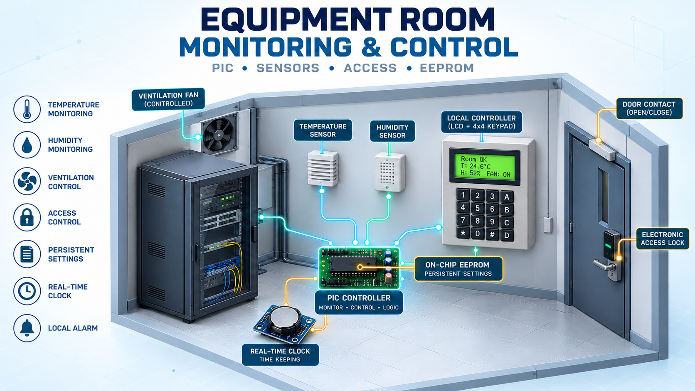
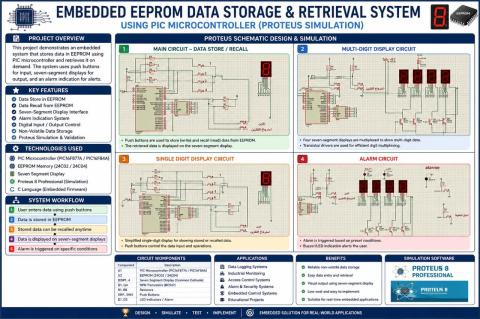

# PIC-Based Equipment Room Monitoring & Control System

[Read case study](https://mahyoub88.github.io/projects/proj-embedded-iot/) · [Complete engineering guide](docs/engineering-guide.md) · [Original implementation archive](docs/pic-peripheral-implementations.md)

A PIC-based local equipment-room controller combining temperature/humidity sensing, ventilation control, keypad access, door monitoring, local alarms, RTC timekeeping and persistent EEPROM settings.

The room-level system is a proposed integrated reference design built on the preserved PIC peripheral and EEPROM implementations. Original implementation media is kept unchanged; new diagrams and the AI-generated cover are clearly identified.

*AI-generated concept illustration; not an installation photograph.*

## What the system does

- Measures temperature and humidity, displays status and identifies unavailable sensors.
- Controls ventilation with hysteresis; commands fan ON on stale temperature.
- Provides keypad access, a timed lock-release pulse, exit request and door alarms.
- Retains confirmed settings with a proposed dual-slot EEPROM record.
- Keeps RTC-based time and supports an optional access window.

## Documentation

The [engineering guide](docs/engineering-guide.md) contains requirements, BOM, DIP-40 pin map, wiring, seven diagrams, calculations, scheduling, fault behavior, EEPROM layout and commissioning scenarios.

| Artifact | Purpose |
|---|---|
| [Architecture](img/equipment-room/01-architecture.svg) | Inputs, PIC, outputs, RTC and internal EEPROM |
| [Pin and wiring map](img/equipment-room/02-pin-and-wiring-map.svg) | GPIO allocation and connectors |
| [Output driver](img/equipment-room/03-output-driver.svg) | Low-voltage actuator driver and protection |
| [Firmware flow](img/equipment-room/04-control-flow.svg) | Scheduling and fault response |
| [Access states](img/equipment-room/05-access-states.svg) | Code entry, release, lockout and door alarm |
| [EEPROM layout](img/equipment-room/06-eeprom-layout.svg) | Validated persistent settings |
| [Power distribution](img/equipment-room/07-power-distribution.svg) | Logic/load supplies and reset |
| [Executable control model](reference/room-controller.mjs) | Behavioral reference, not PIC binary |
| [Verification tests](tests/room-controller.test.mjs) | State logic and interrupted writes |
| [Firmware integration](firmware/README.md) | mikroC interfaces and device bring-up |

## Run reference verification

Requires Node.js 18 or newer; no external packages.

~~~sh
node --test tests/room-controller.test.mjs
~~~

## Preserved original implementation media

*Original implementation poster, unchanged. Existing screenshots document earlier EEPROM work, not a completed equipment-room installation.*

[Earlier PIC implementation documentation](docs/pic-peripheral-implementations.md) retains all peripheral explanations and media. [Media integrity manifest](docs/original-media-manifest.json) records preserved file hashes.

## Implementation status

The original peripheral/EEPROM work is retained. The integrated room design and executable model are new documentation. Hardware assembly, a compiled mikroC project, calibration and room commissioning still need physical verification.

**Author:** Mohammed Mahyoub · [Portfolio](https://mahyoub88.github.io/)
