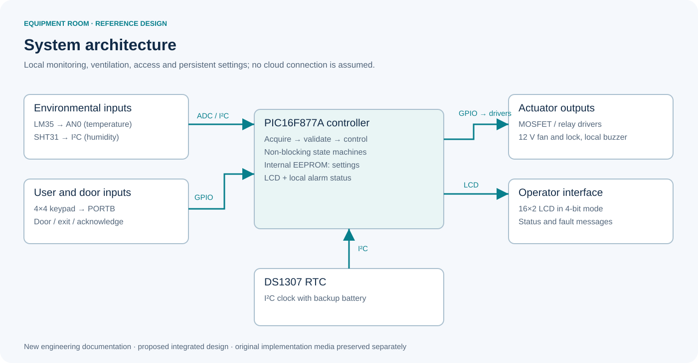
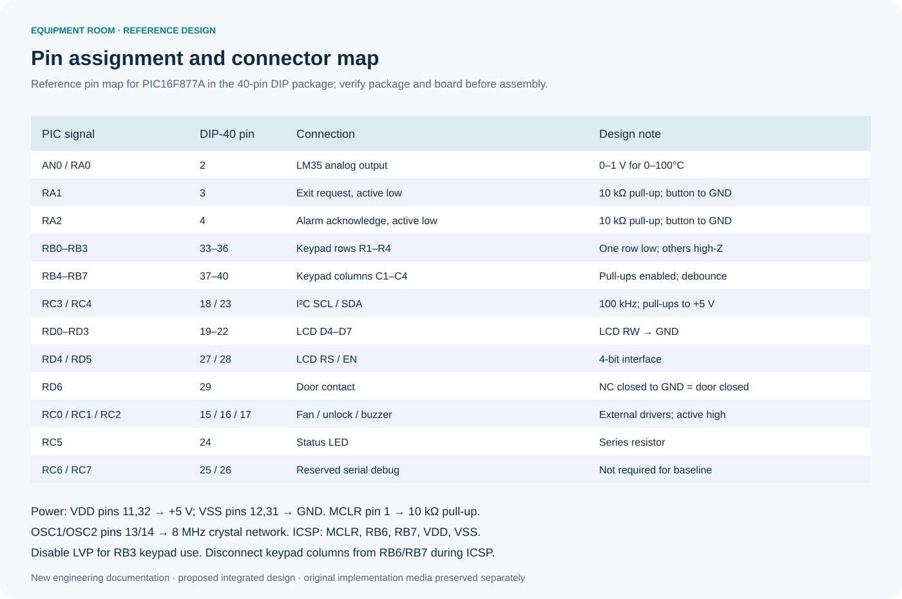
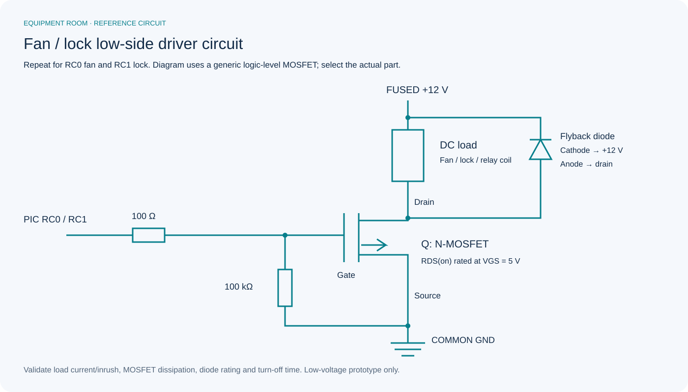
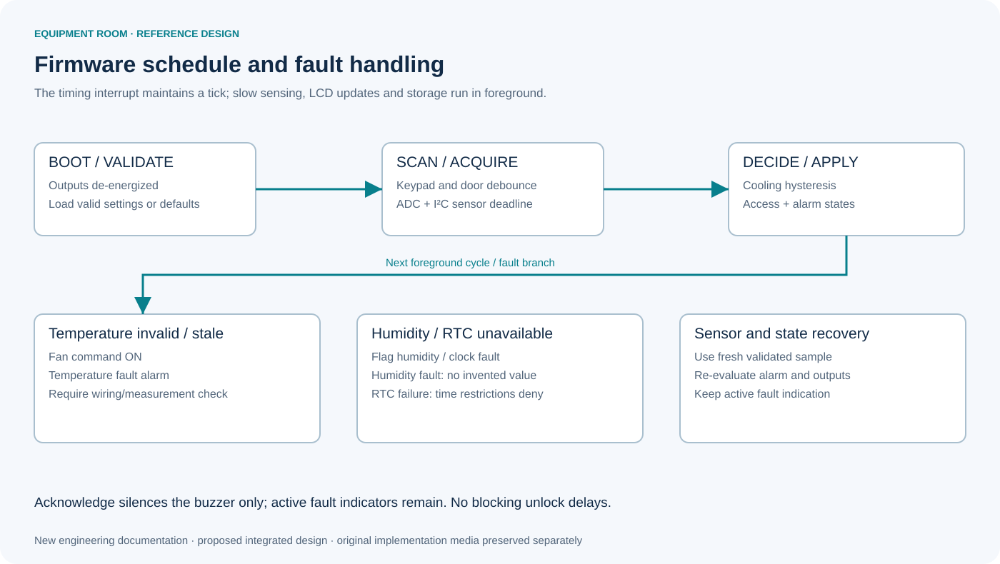
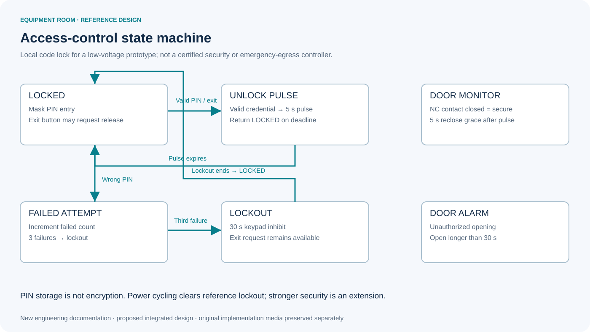
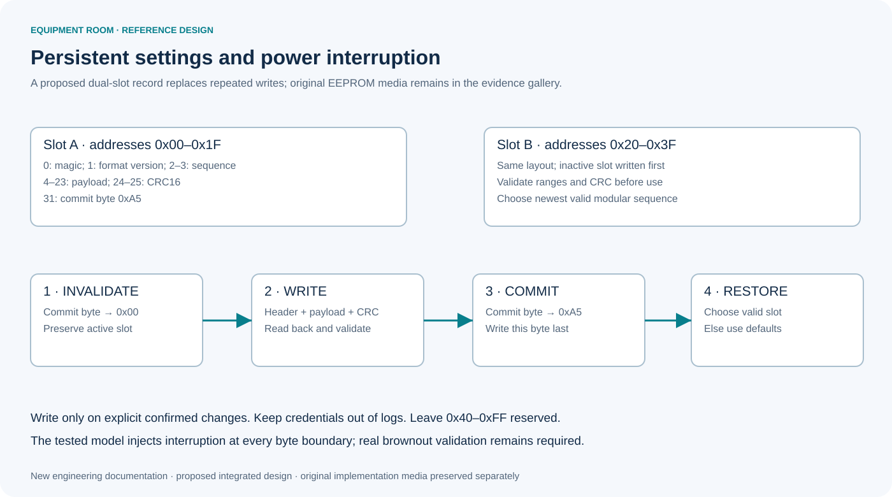
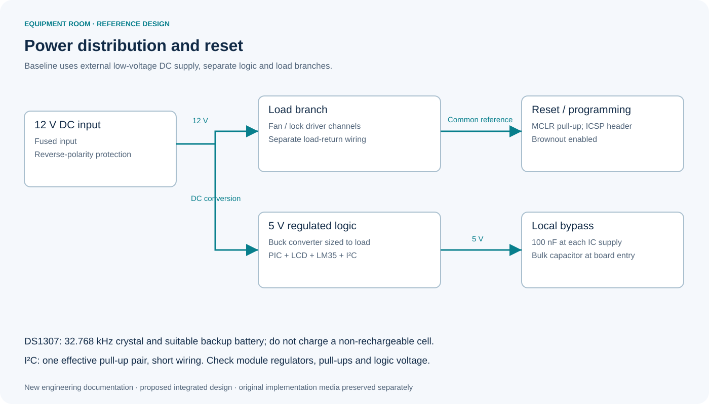

# PIC-Based Equipment Room Monitoring & Control System

## Purpose and scope

A local controller for a small equipment room or electronics cabinet. It monitors temperature, humidity and door state, commands ventilation, supports keypad access and exit release, displays status and retains settings after power removal.

This is the proposed integrated application of the preserved PIC peripheral and EEPROM implementations. The original media documents those earlier building blocks. The new room layout, wiring map, firmware model, default thresholds and validation plan are reference design artifacts, not evidence of a newly installed complete room system.

## Requirements

| ID | Requirement | Verification |
|---|---|---|
| R01 | Sample temperature and humidity once per second | Inject changing and invalid values |
| R02 | Use fan ON/OFF hysteresis | Sweep across both limits |
| R03 | Flag stale temperature; command fan ON | Stop valid samples for >3 s |
| R04 | Unlock on valid PIN or exit request | Valid/invalid code and exit tests |
| R05 | Relock after a timed pulse | Check output deadline without blocking sensing |
| R06 | Alarm on unauthorized or prolonged opening | Door contact scenarios |
| R07 | Acknowledge buzzer without clearing faults | Active fault + acknowledge |
| R08 | Retain confirmed settings after power cycle | Save, restart and compare |
| R09 | Reject corrupt/incomplete EEPROM records | Byte-boundary interrupted-write tests |
| R10 | Display RTC status; reject restricted access if time invalid | Remove RTC response |

## Reference hardware and bill of materials

Quantities and selections define a prototype baseline; load ratings require actual parts selection.

| Qty | Component | Function / selection criteria |
|---|---|---|
| 1 | PIC16F877A, DIP-40 | 5 V controller, 10-bit ADC, I²C, internal EEPROM |
| 1 | 8 MHz crystal + load capacitors | Match crystal load specification; do not assume capacitor value |
| 1 | LM35 temperature sensor | 5 V supply, 10 mV/°C analog output to AN0 |
| 1 | SHT31-DIS compatible module | Humidity via I²C; verify module supports the 5 V bus |
| 1 | DS1307 RTC assembly | Crystal, backup cell, I²C; inspect charging circuit |
| 1 | 16×2 HD44780-compatible LCD | 5 V, 4-bit mode, contrast potentiometer |
| 1 | 4×4 matrix keypad | 8 GPIO; masked local PIN entry |
| 1 | NC magnetic door contact | Closed contact to GND indicates closed door |
| 2 | Momentary buttons | Exit release and alarm acknowledge |
| 1 each | 12 V fan and 12 V lock prototype | Actual current/inrush determines driver sizing |
| 2 | Logic-level N-MOSFET channels | Rated at 5 V gate drive, with protection and gate pull-down |
| 1 | Buzzer driver + status LED | Match buzzer current; LED series resistor |
| 1 | 12 V DC supply + 5 V buck converter | Size from load budget and simultaneous activation |
| As needed | Fuses, diode protection, bypass caps, connectors | Local decoupling, common reference, separated load paths |

## System diagrams

### 1. architecture

### 2. pin and wiring map

### 3. output driver

### 4. control flow

### 5. access states

### 6. eeprom layout

### 7. power distribution

## Pin map

| Signal | DIP-40 pin | Connection | Design note |
|---|---|---|---|
| AN0 / RA0 | 2 | LM35 analog output | 0–1 V for 0–100°C |
| RA1 | 3 | Exit request, active low | 10 kΩ pull-up; button to GND |
| RA2 | 4 | Alarm acknowledge, active low | 10 kΩ pull-up; button to GND |
| RB0–RB3 | 33–36 | Keypad rows R1–R4 | One row low; others high-Z |
| RB4–RB7 | 37–40 | Keypad columns C1–C4 | Pull-ups enabled; debounce |
| RC3 / RC4 | 18 / 23 | I²C SCL / SDA | 100 kHz; pull-ups to +5 V |
| RD0–RD3 | 19–22 | LCD D4–D7 | LCD RW → GND |
| RD4 / RD5 | 27 / 28 | LCD RS / EN | 4-bit interface |
| RD6 | 29 | Door contact | NC closed to GND = door closed |
| RC0 / RC1 / RC2 | 15 / 16 / 17 | Fan / unlock / buzzer | External drivers; active high |
| RC5 | 24 | Status LED | Series resistor |
| RC6 / RC7 | 25 / 26 | Reserved serial debug | Not required for baseline |

VDD: pins 11 and 32. VSS: pins 12 and 31. MCLR: pin 1 with 10 kΩ pull-up. OSC1/OSC2: pins 13/14. Disable low-voltage programming to use RB3 for keypad scanning. RB6/RB7 serve ICSP; isolate the keypad during programming.

## Wiring details

- LM35: connect supply and ground according to the selected package pinout; output → RA0/AN0. The simple baseline measures non-negative temperatures. Keep sensor wiring away from switched load current. Add an analog filter only after checking source impedance and ADC acquisition requirements.
- SHT31 and DS1307 share RC3/SCL and RC4/SDA at 100 kHz. SHT31 ADDR low gives 7-bit address 0x44; DS1307 is 0x68. Use one effective pull-up pair; 4.7 kΩ is an initial short-bus value to validate, not a universal requirement. Bare SHT3x supports a supply range that includes 5 V, but breakout boards may differ.
- LCD: RD0–3 → D4–7; RD4 → RS; RD5 → EN; RW → GND. Connect contrast wiper to VO. Follow module backlight-current requirements rather than assuming a resistor is fitted.
- Keypad: drive only the selected row low and leave other rows as inputs/high impedance; columns are inputs with pull-ups. Require a stable press/release and reject simultaneous ambiguous keys. Disable LVP; no pin may be driven simultaneously by keypad and ICSP programmer.
- Door: NC contact closed to ground; external 10 kΩ pull-up to 5 V; RD6 reads high when open or disconnected. This detects an open wire as open door, but does not detect every short-circuit fault.
- Exit and acknowledge: separate normally-open contacts to ground with pull-ups. Exit request remains usable during keypad lockout. Emergency egress must remain independent of firmware.
- Fan/lock: PIC output → 100 Ω gate resistor → selected logic-level MOSFET; 100 kΩ gate pull-down; source → ground; drain → load negative. Load positive → fused 12 V. Inductive coil flyback diode cathode → 12 V, anode → drain. Select current, inrush, voltage, diode and thermal ratings from the actual load.

## Measurement and calibration

LM35 conversion with measured ADC reference: temperature °C = ADC_count × Vref_mV / (1023 × 10). With Vref = 5000 mV, one count is approximately 0.489°C; this is quantization, not total accuracy. Average several settled readings and compare against a reference thermometer. A short to ground can resemble 0°C, so range checks alone do not prove sensor health.

For SHT31, issue the documented single-shot measurement command, wait for its specified conversion completion, read six bytes, verify both CRC bytes, then convert humidity: RH = 100 × raw_RH / 65535. Retain a timestamp only for a valid sample. A stale or CRC-failed value must not be displayed as a current measurement. Sensor CRC uses polynomial 0x31 with initial value 0xFF.

## Example settings

These are demonstration values, not environmental operating limits for a particular room.

| Setting | Default | Meaning |
|---|---|---|
| Fan OFF | 28°C | Stop fan at/below this value |
| Fan ON | 32°C | Start fan at/above this value |
| High-temperature alarm | 40°C | Local critical-temperature indication |
| High humidity | 70% RH | Alarm only; ventilation is not assumed to dehumidify |
| Stale measurement | 3 seconds | Temperature fault and fan command ON |
| Unlock pulse | 5 seconds | Timed release |
| Door-open alarm | 30 seconds | Prolonged opening |
| Wrong PIN attempts | 3 | Enter keypad lockout |
| Lockout duration | 30 seconds | Inhibit keypad access; allow exit request |
| Access time window | Disabled | Optional RTC-based restriction |

Validate OFF < ON < high-temperature threshold, humidity in 1–100%, timing bounds and credential format. Reject invalid changes without replacing known-good settings.

## Firmware architecture

1. Initialize output latches LOW before enabling output pins; the hardware gate pull-downs keep loads de-energized during reset.
2. Load newest valid EEPROM settings, or defaults with a visible configuration warning.
3. Start a monotonic millisecond timebase. For an 8 MHz oscillator, Timer2 prescaler 1:16, PR2 = 249, postscaler 1:2 produces a nominal 4 ms tick. Timer ISR only increments the tick. Configure registers against the device data sheet and verify timing on hardware.
4. Foreground tasks: keypad/door debounce at 20 ms; environment acquisition at 1000 ms; LCD refresh at 250 ms; RTC read at 1000 ms; output decisions every pass.
5. Implement cooling, access and alarms as independent states. Never stop sensing while waiting for a code, alarm or unlock timeout.
6. On EEPROM save, keep the old valid slot until the replacement record has been written, checked and committed. The PIC EEPROM library may briefly block or mask interrupts; characterize this and compensate the timebase or defer saves while a timed release is active.

### Cooling

Start fan at ON threshold; hold its previous state within the hysteresis band; stop at OFF threshold. Missing/stale temperature commands fan ON and raises a fault. This is a command policy, not proof of airflow: add fan feedback if detecting a stalled or disconnected fan is required. High humidity raises an alarm; no humidity-driven fan action is assumed.

### Access

Mask entered digits. Confirm using #; clear with *. Match a provisioned credential, then pulse unlock. Three wrong codes trigger timed keypad lockout and an alarm. Physical exit request releases independently of keypad lockout. Door opening without a current authorization window or exit request is flagged; monitor prolonged opening independently. Do not retrigger unlock indefinitely from a held button.

The reference keypad lock is not a certified security system. PIN bytes in EEPROM are not encryption, and reference lockout resets on power cycle. Use stronger credential protection, persistent rate limiting, tamper detection and independent emergency egress for a real secured installation.

### Alarms and display

Priority: temperature invalid → high temperature → unauthorized door → prolonged door opening → humidity invalid/high → RTC fault → configuration warning → normal. Acknowledge silences the buzzer for the current active set; visual fault indications remain and a new alarm condition reactivates the buzzer. Display measured temperature, RH, fan state, door state and RTC validity on alternating 16-character screens. Display values are examples, not measured results.

## EEPROM record

Two 32-byte slots use 64 of the PIC's 256 EEPROM bytes. Bytes 0–1 identify magic/version; 2–3 hold a sequence counter; 4–23 hold thresholds, timings, optional schedule and a provisioned PIN; 24–25 store CRC16-CCITT (initial 0xFFFF); byte 31 is commit 0xA5. Unused bytes stay reserved.

Save sequence: invalidate inactive slot → write header/payload/CRC → read back and verify → commit last → use newest valid slot. Modular sequence comparison handles wraparound. Validate field ranges after CRC; CRC alone does not establish semantic validity or malicious-tamper resistance. Save only confirmed changes; never write every sensor sample. No event-history database is included in the baseline.

## Failure matrix

| Condition | Reference response | Remaining limitation |
|---|---|---|
| Invalid/stale temperature | Fan command ON; fault alarm | Open/short detection needs hardware diagnostics |
| Humidity CRC/NACK/stale | Mark RH unavailable; fault alarm | Cooling still follows temperature |
| RTC NACK/CH bit invalid | Flag clock; deny restricted keypad entry | Unrestricted entry and exit still operate |
| Both settings slots invalid | Defaults + warning | Provision credential before access |
| Reset / brownout | Outputs LOW, validate, reacquire | Real lock choice determines power-loss state |
| Door line open | Treat as door open | Short to ground is not detected |
| Fan drive ON but fan stopped | No airflow proof | Add tachometer/current feedback |

## Verification and commissioning

The executable reference model is tested with Node's built-in test runner: run `node --test tests/room-controller.test.mjs`. This verifies logic, not a compiled PIC image or physical hardware.

| Test | Procedure | Expected result |
|---|---|---|
| Power rails | Measure 12 V/5 V unloaded and switching loads | Within selected component limits |
| I²C | Identify devices, disconnect each, corrupt a model CRC | Correct device/fault status |
| Temperature | Compare reference instrument, sweep ADC input | Correct scale; documented calibration |
| Hysteresis | 27 → 33 → 30 → 28°C | OFF → ON → ON → OFF |
| Stale temperature | Stop valid acquisition >3 s | Fan ON + fault |
| Access | Wrong codes, correct code, held buttons, exit | Lockout/pulse/no indefinite release |
| Door | Authorized open, unauthorized open, long open | Appropriate alarms without blocking |
| EEPROM | Interrupt every write boundary, restart | Old or fully committed new settings |
| Reset during release | Reset while lock output ON | Output returns to reset state |
| Acknowledge | Ack current fault, introduce different fault | Visual state remains; new buzzer alarm |
| Timing | Scope tick/output pulse with EEPROM saves | Actual deadlines documented |

Record real instrument values, firmware version, schematic revision and photographs before calling the integrated system built/tested. No such new measurements are invented here.

## Original implementation media and provenance

- [Original EEPROM project poster](../img/persistent-storage/00_project_poster.jpg): preserved unchanged at its existing resolution. It contains implementation/simulation screenshots and is not a photograph of an installed equipment room.
- [Existing EEPROM summary image](overview/eeprom-system.jpg): preserved unchanged.
- [Earlier PIC implementation documentation](pic-peripheral-implementations.md): retained complete.
- Original peripheral SVGs remain unchanged; their explanatory captions distinguish them from physical implementation evidence.
- The PLC poster remains in the repository as historical related material; it is not presented as a component of this PIC room controller.

## Primary technical references

- [Microchip PIC16F87XA data sheet](https://ww1.microchip.com/downloads/en/devicedoc/39582b.pdf)
- [TI LM35 data sheet](https://www.ti.com/lit/ds/symlink/lm35.pdf)
- [Sensirion SHT3x-DIS data sheet](https://sensirion.com/media/documents/213E6A3B/63A5A569/Datasheet_SHT3x_DIS.pdf)
- [Analog Devices DS1307 data sheet](https://www.analog.com/media/en/technical-documentation/data-sheets/DS1307.pdf)

## Extensions

Fan feedback, tamper supervision, external event storage, an isolated communications link and a documented remote-monitoring protocol are optional extensions. They are not claimed as implemented baseline features.
