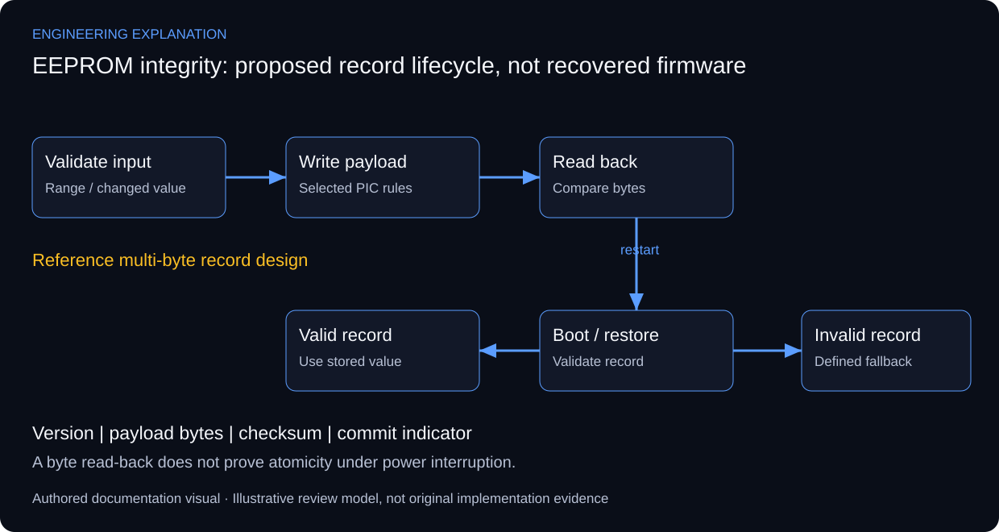

# Embedded EEPROM Data Storage & Retrieval System

## Persistence is a write, restore and integrity problem

The implemented function is storage and retrieval in the PIC microcontroller’s internal data EEPROM, developed with mikroC and Proteus. This is not an external I2C EEPROM design. The source poster documents the project, while the complete original firmware and Proteus schematic remain outside the public release.

Non-volatile memory retains bytes through power removal, but a multi-byte application record needs its own integrity convention. Writing a value, reading it back and restoring it on boot are distinct operations. A byte read-back confirms that operation at that instant; it does not prove a complete multi-byte update will survive interruption.

An explanatory record design can include a version, payload and checksum, with a commit indicator written after the payload. A stronger design may alternate between two slots and choose the latest valid record. These are documentation options, not recovered features of the original firmware. Checksum detection also differs from error correction: an invalid record still needs a defined fallback.

Write endurance makes repeated storage of an unchanged value undesirable. The selected PIC data sheet and library govern write completion, unlocking and interrupt treatment. A fixed delay in a short reference snippet is not a portable device specification. For verification, distinguish successful writes, rejected values, restart recovery and interruption during the update.

*New explanatory responsibilities and review criteria; not an as-built drawing or new test result.*

## Review scenarios and expected evidence

These are review criteria, not additional completed tests.

| Review area | Method | Evidence to inspect |
|---|---|---|
| Unchanged input | Repeat the same value | Avoid unnecessary write in the reference design |
| Boundary values | Use valid minimum/maximum and out-of-range input | Accept or reject without address overflow |
| Power cycle | Store, remove power, restart | Restored value associated with its integrity status |
| Interrupted update | Interrupt a multi-byte reference update | Invalid record detected; recovery behaviour specified |

## Primary technical references

- [Microchip PIC16F87XA data sheet](https://ww1.microchip.com/downloads/en/devicedoc/39582b.pdf)

References support the explanation, not undocumented implementation claims.

Integrity layouts and interruption scenarios are reference design guidance. They are not proof that a checksum or dual-slot scheme exists in the original code.

[Published case study](https://mahyoub88.github.io/projects/proj-eeprom-storage/).
