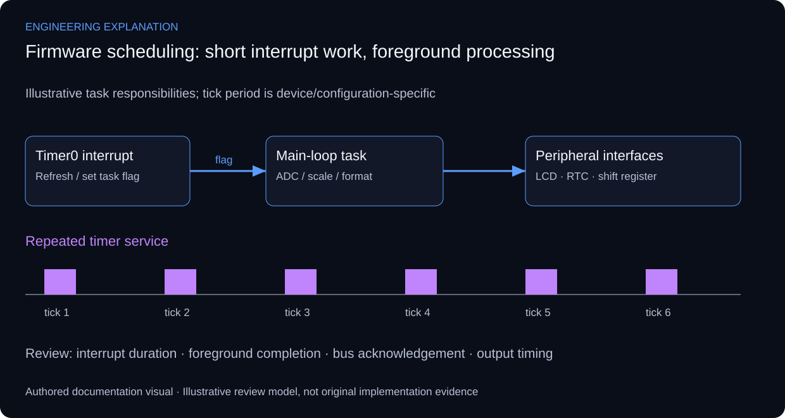

# PIC Embedded Systems — Peripheral Integration & Persistent Storage

## Timing and peripheral integration responsibilities

This project groups PIC firmware and peripheral implementations: multiplexed displays, timed ADC sensing, the DS1307 RTC, 74HC595 output expansion, keypad access control and the Nokia 5110 display. It is an integration portfolio rather than a claim that every peripheral appears on one physical board. On-chip EEPROM persistence is included in this consolidated project. See [Persistent storage](../../README.md#persistent-storage) and the [storage walkthrough](proj-eeprom-storage.md).

The central design distinction is between time-critical service and slower foreground work. A display-refresh interrupt advances the active digit; scheduled sampling, conversion, formatting and user-interface updates belong in the foreground where practical. A timing diagram should identify the selected oscillator, timer prescaler and reload before deriving a refresh rate. The public examples explain scheduling, but do not establish those settings for every original build.

Analog conversion depends on the selected PIC, reference voltage, acquisition interval and channel configuration. A raw ADC count is not a calibrated physical measurement until the sensor transfer relationship and reference are known. Likewise, a responsive I2C clock requires both electrical compatibility and correct transaction handling; the NXP reference explains bus behaviour, while the device data sheet determines the actual limits.

The engineering review connects each peripheral to its interface, timing needs and failure symptom. A stuck display, unstable analog value and missing RTC acknowledgement should lead to different checks. Reference snippets remain examples: port assignments, register names, drive currents and peripheral voltage compatibility must be checked against the actual board.

*New explanatory responsibilities and review criteria; not an as-built drawing or new test result.*

## Review scenarios and expected evidence

These are review criteria, not additional completed tests.

| Review area | Method | Evidence to inspect |
|---|---|---|
| Multiplexed display | Blank before changing shared segment data | Digit-selection and segment waveforms |
| ADC input | Check reference, channel and acquisition context | Raw count, conversion formula and known input |
| DS1307 RTC | Inspect bus wiring, pull-ups and acknowledgement | Transaction capture and returned time |
| 74HC595 / outputs | Separate shift clock, latch and output enable | Known bit pattern at the intended outputs |

## Primary technical references

- [Microchip PIC16F87XA data sheet](https://ww1.microchip.com/downloads/en/devicedoc/39582b.pdf)
- [NXP — I2C specification UM10204](https://community.nxp.com/pwmxy87654/attachments/pwmxy87654/nxp-designs/931/1/UM10204.pdf)

References support the explanation, not undocumented implementation claims.

Timing values and pin assignments are device-specific. No new board photograph, Proteus capture or original firmware export is claimed.

[Published case study](https://mahyoub88.github.io/projects/proj-embedded-iot/).
